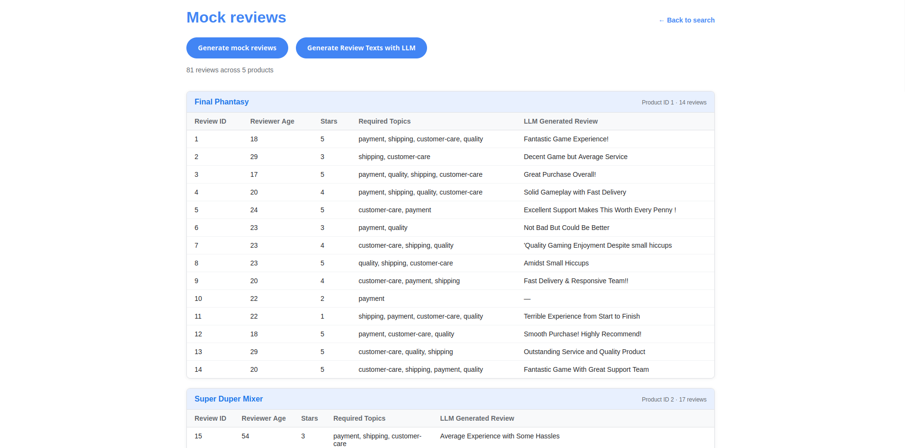

# Product Review Summarizer - Langchain4J 

## Concept
Fetching the reviews from an e-commerce website and summarizing them for 
- Customers, who are interested in the product. Each review category is separately summerized. 
- Different product teams like shipping department, customer service so they can improve.

## Reviews
Reviews are synthetic and created using LLMs.  
The prompt can be found here: [Prompt](src/main/resources/prompt.md)  
The LLM only takes care of review generation. Deterministic things are done manually.

#### Steps
1. [product](src/main/resources/products-review-config.json) contains the configuration of the reviews for a product
2. Using products-review-config [reviews](src/main/resources/reviews.json) is created with sudo randomness. Checkout [ProductReviewJsonGeneratorService](src/main/kotlin/com/currymeister/productreviewsummarizer/service/ProductReviewJsonGeneratorService.kt)
3. [LLMReviewGenerationService.kt](src/main/kotlin/com/currymeister/productreviewsummarizer/service/LLMReviewGenerationService.kt) is used for calling an LLM and the result is stored in [reviews-result.json](src/main/resources/reviews-result.json)

## External APIs
For summerizing and generating reviews, OPENAI API is used.

## Caching
For cost saving purposes, caching would be used.

