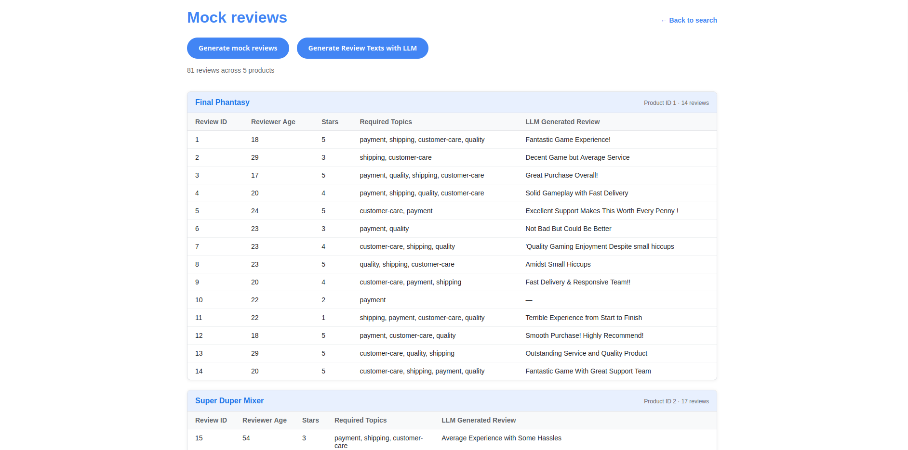

# Product Review Summarizer - Langchain4J 

## Concept
Fetching the reviews from an e-commerce website and summarizing them for 
- Customers, who are interested in the product. Each review category is separately summerized. 
- Different product teams like shipping department, customer service so they can improve.

## Reviews
Reviews are synthetic and created using LLMs.  
The prompt can be found here: [Prompt](src/main/resources/prompt.md)  
The LLM only takes care of review generation. Deterministic things are done manually.

#### Steps
1. Products, required topics and review generation settings are stored in Postgres (`products`, `required_topics`, `product_review_config`), created by the Flyway migrations.
2. [ProductReviewService.kt](src/main/kotlin/com/currymeister/productreviewsummarizer/service/ProductReviewService.kt) generates mock reviews with sudo randomness and persists them to `product_reviews` and `product_review_required_topics`.
3. [LLMReviewGenerationService.kt](src/main/kotlin/com/currymeister/productreviewsummarizer/service/LLMReviewGenerationService.kt) calls an LLM for reviews that do not have generated text yet and stores the title/text back on the review row.

## External APIs
For summerizing and generating reviews, OPENAI API is used.

## Caching
For cost saving purposes, caching would be used.

